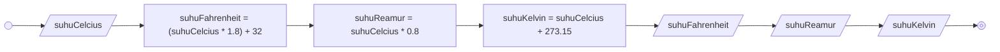

# Minitask Algoritma Implementasi 

## Algoritma konversi suhu 

### Deskriptif 
1. Mulai
2. Masukkan nilai suhu celcius
3. Hitung nilai suhu fahrenheit dengan suhu celcius dikali 1.8 kemudian ditambah 32
4. Hitung nilai suhu reamur dengan suhu celcius dikali 0.8
5. Hitung nilai suhu kelvin dengan nilai suhu celcius ditambah 273.15
6. Tampilkan nilai suhu fahrenheit
7. Tampilkan nilai suhu reamur
8. Tampilkan nilai suhu kelvin
9. Selesai 

### Flowchart 



### Pseudocode 
```
DECLARE suhuFahrenheit : REAL
DECLARE suhuReamur: REAL
DECLARE suhuKelvin: REAL

INPUT suhuCelcius 

suhuFahrenheit <- (suhuCelcius * 1.8) + 32
suhuReamur <- suhuCelcius * 0.8
suhuKelvin <- suhuCelcius + 273.15

OUTPUT suhuFahrenheit 
OUTPUT suhuReamur 
OUTPUT suhuKelvin
```
