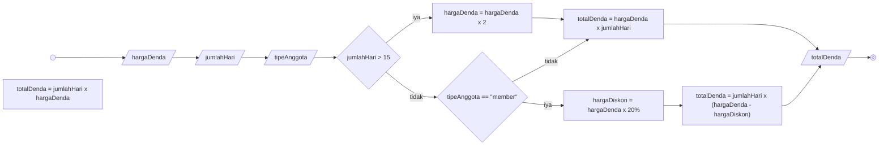

# Algorithm Implementation

## Algoritma penentuan denda pengembalian buku perpustakaan

### Deskriptif
1. Mulai
2. Masukkan harga denda
3. Masukkan jumlah hari keterlambatan
4. Masukkan tipe anggota perpustakaan
5. Jika jumlah hari keterlambatan lebih dari 15 hari
6. Maka harga denda dikali 2
7. Hitung total denda dengan jumlah hari dikali harga denda
8. Jika jumlah hari keterlambatan tidak lebih dari 15 hari
9. maka harga denda dikali 1
10. Jika tipe anggota perpustakaan adalah "member"
11. maka harga diskon nya adalah harga denda dikali 20%
12. Hitung total denda dengan jumlah hari dikali harga denda yang sudah dikurangi dengan harga diskon
13. Jika bukan member
14. Hitung total denda dengan jumlah hari dikali harga denda
15. Tampilkan total denda
16. Selesai

### Flowchart


### Pseudocode
```
DECLARE hargaDenda : INTEGER
DECLARE jumlahHari : INTEGER
DECLARE totalDenda : REAL
DECLARE hargaDiskon : REAL
DECLARE tipeAnggota : STRING

IF jumlahHari > 15 THEN
  hargaDenda <- hargaDenda * 2
  totalDenda <- hargaDenda * jumlahHari
ELSE
  IF tipeAnggota = "member" THEN
    hargaDiskon <- hargaDenda * 0.2
    totalDenda <- jumlahHari * (hargaDenda - hargaDiskon)
  ELSE
    totalDenda <- jumlahHari * hargaDenda
  ENDIF
ENDIF

OUTPUT totalDenda
```
