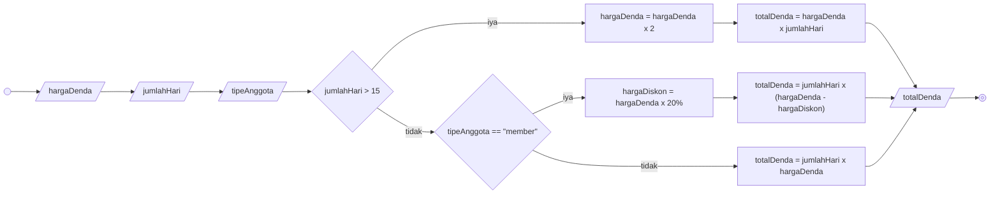

# Algorithm Implementation

## Algoritma penentuan denda pengembalian buku perpustakaan

### Deskriptif
1. Mulai
2. Masukkan hargaDenda
3. Masukkan jumlahHari keterlambatan
4. Masukkan tipeAnggota perpustakaan
5. Jika jumlahHari keterlambatan lebih dari 15 hari
6. Maka hargaDenda dikali 2
7. Hitung totalDenda dengan jumlahHari dikali hargaDenda
8. Tampilkan totalDenda
9. Jika jumlahHari keterlambatan tidak lebih dari 15 hari
10. maka hargaDenda dikali 1
11. Jika tipeAnggota perpustakaan adalah "member"
12. maka hargaDiskon nya adalah hargaDenda dikali 20%
13. Hitung totalDenda dengan jumlahHari dikali hargaDenda yang sudah dikurangi dengan hargaDiskon
14. Tampilkan totalDenda
15. Jika bukan member
16. Hitung totalDenda dengan jumlahHari dikali hargaDenda
17. Tampilkan totalDenda
18. Selesai

### Flowchart


### Pseudocode
```
DECLARE hargaDenda : INTEGER
DECLARE jumlahHari : INTEGER
DECLARE totalDenda : REAL
DECLARE hargaDiskon : REAL
DECLARE tipeAnggota : STRING

IF jumlahHari > 15 THEN
  hargaDenda <- hargaDenda * 2
  totalDenda <- hargaDenda * jumlahHari
  OUTPUT totalDenda
ELSE
  IF tipeAnggota = "member" THEN
    hargaDiskon <- hargaDenda * 0.2
    totalDenda <- jumlahHari * (hargaDenda - hargaDiskon)
    OUTPUT totalDenda
  ELSE
    totalDenda <- jumlahHari * hargaDenda
    OUTPUT totalDenda
  ENDIF
ENDIF
```
